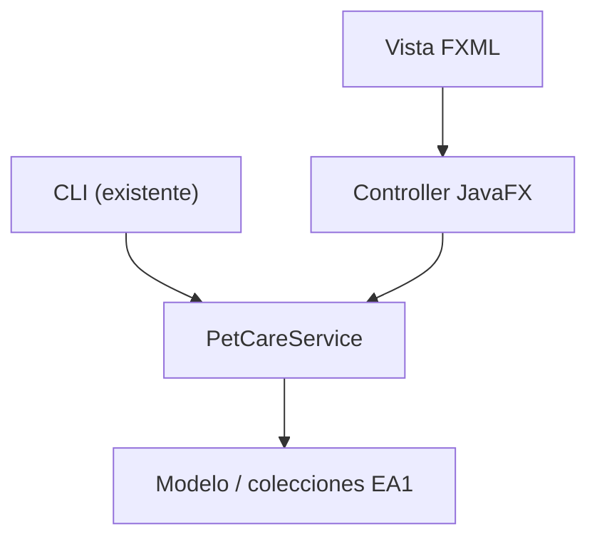

# PetCare · Modelo y checkpoint · Semana 09

## Paquetes conceptuales
`core.model` y `core.service` continúan libres de `javafx.*`. `cli` y `ui` son dos formas de interacción; ninguna debe absorber reglas de negocio.

## Checklist técnico
- [ ] El core sigue compilando.
- [ ] UI JavaFX carga FXML.
- [ ] `fx:id` y `onAction` corresponden al Controller.
- [ ] Controller invoca un servicio existente.
- [ ] El servicio conserva las colecciones/validaciones de EA1.
- [ ] Error inválido visible y controlado.

## Evidencia
Comando Maven, captura de ejecución, prueba negativa, diagrama adaptado y commits.

## Defensa
1. ¿Qué cambiarías para usar una UI distinta?
2. ¿Qué podría seguir ejecutándose sin JavaFX?
3. ¿Por qué no guardaste la lista de mascotas dentro del Controller?
4. ¿Cómo distinguirías un error de validación de un error al cargar FXML?

## Próxima semana
Consolidar Controller/servicio y flujo de datos antes de introducir nuevas vistas o persistencia según la orientación vigente.
